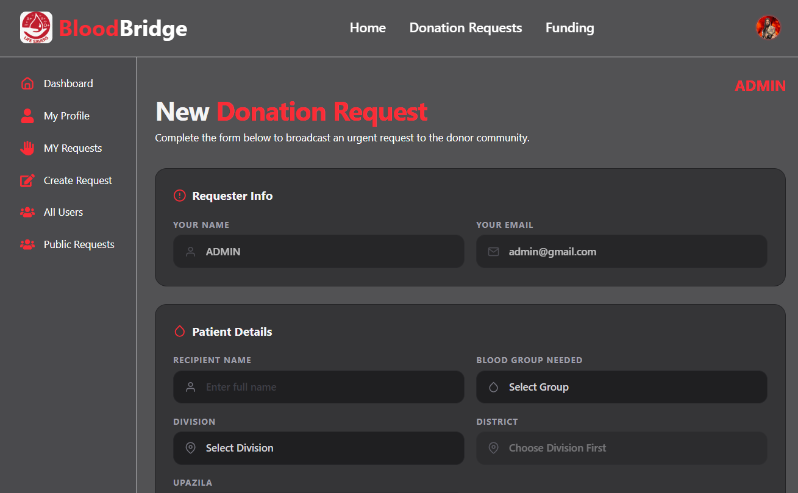
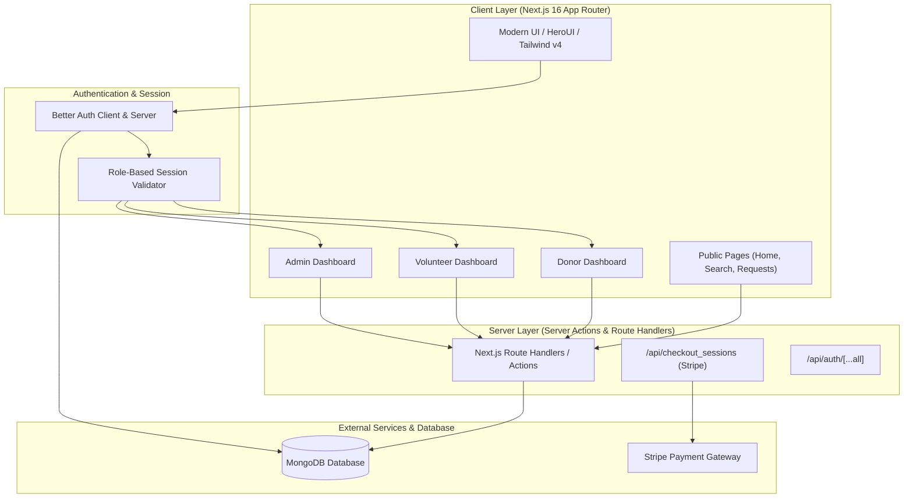

<div align="center">

# 🩸 BloodBridge — Blood Donation Management Platform
### A full-stack blood donation platform with emergency requests, donor discovery, RBAC, and Stripe payments.

<a href="https://assignment-10-client-sooty.vercel.app/" target="_blank">
  
</a>

<p align="center">
    <strong>BloodBridge — A real-time blood donation platform connecting life-saving donors with critical blood requests. Features live inventory tracking, instant donor search, emergency request management, and a built-in blood compatibility guide.</strong>
  </p>

[](https://nextjs.org/)
[](https://react.dev/)
[](https://tailwindcss.com/)
[](https://heroui.com/)
[](https://www.mongodb.com/)
[](https://better-auth.com/)
[](https://stripe.com/)
[](https://vercel.com/)
[](LICENSE)

<br />
<br />

[🌐 **Live Demo**](https://assignment-10-client-sooty.vercel.app) • [📂 **GitHub Repository**](https://github.com/eyasinarafat3485-gif/assignment-10) • [🐛 **Report Bug**](https://github.com/eyasinarafat3485-gif/assignment-10/issues) • [✨ **Request Feature**](https://github.com/eyasinarafat3485-gif/assignment-10/issues)

</div>

---

## 📋 Table of Contents

- [🩸 BloodBridge — Modern Blood Donation \& Emergency Management Platform](#-bloodbridge--modern-blood-donation--emergency-management-platform)
  - [📋 Table of Contents](#-table-of-contents)
  - [🌟 Overview](#-overview)
  - [✨ Core Features](#-core-features)
    - [1. 🚨 Emergency Blood Requests Hub](#1--emergency-blood-requests-hub)
    - [2. 🔍 Advanced Donor Search \& Geo-Discovery](#2--advanced-donor-search--geo-discovery)
    - [3. 🛡️ Multi-Tier Role-Based Access Control (RBAC)](#3-️-multi-tier-role-based-access-control-rbac)
    - [4. 💳 Crowdfunding \& Community Funding (Stripe)](#4--crowdfunding--community-funding-stripe)
    - [5. 📊 Interactive Health \& Compatibility Tools](#5--interactive-health--compatibility-tools)
    - [6. 🔐 Robust Authentication \& Security](#6--robust-authentication--security)
  - [👥 User Roles \& Permission Matrix](#-user-roles--permission-matrix)
  - [🏗️ System Architecture](#️-system-architecture)
  - [💻 Tech Stack](#-tech-stack)
    - [Frontend Architecture](#frontend-architecture)
    - [Backend, Auth \& Database](#backend-auth--database)
    - [Payments \& Tooling](#payments--tooling)
  - [📂 Directory Structure](#-directory-structure)
  - [🚀 Getting Started](#-getting-started)
    - [Prerequisites](#prerequisites)
    - [1. Clone Repository](#1-clone-repository)
    - [2. Install Dependencies](#2-install-dependencies)
    - [3. Configure Environment Variables](#3-configure-environment-variables)
    - [4. Run Development Server](#4-run-development-server)
    - [5. Build for Production](#5-build-for-production)
  - [⚙️ Environment Configuration Reference](#️-environment-configuration-reference)
  - [🛣️ Application Routes](#️-application-routes)
  - [🔮 Future Roadmap](#-future-roadmap)
  - [🤝 Contributing](#-contributing)
  - [📄 License](#-license)
  - [👨‍💻 Author \& Contact](#-author--contact)

---

## 🌟 Overview

In critical health emergencies, every second counts. Finding a compatible blood donor in close geographical proximity is often the determining factor between life and death.

**BloodBridge** (LifeStream) is an end-to-end modern web application built to eliminate this friction. It empowers patients and hospitals to broadcast urgent blood requests, enables volunteers to coordinate fulfillment, and allows donors to manage availability and respond to calls for help immediately.

---

## ✨ Core Features

### 1. 🚨 Emergency Blood Requests Hub
- **Public & Filterable Request Feed**: View all live requests with instant badges indicating required blood group, hospital location, and deadline.
- **Request Lifecycle Management**: Full state machine tracking:
  - `pending` ➔ `inprogress` ➔ `done` / `canceled`
- **Detailed Request View**: In-depth medical emergency context, contact numbers, full address, and donation confirmation flow.
- **Dedicated Request Creation**: Simple, guided forms with district/upazila cascades and immediate validation.

### 2. 🔍 Advanced Donor Search & Geo-Discovery
- **Parametric Filtering**: Filter donors instantly by:
  - Blood Group (`A+`, `A-`, `B+`, `B-`, `AB+`, `AB-`, `O+`, `O-`)
  - Division, District, and Upazila
- **Donor Availability Status**: Real-time status toggle (`Active` vs. `Unavailable`) ensuring requesters only reach out to eligible donors.

### 3. 🛡️ Multi-Tier Role-Based Access Control (RBAC)
- **👑 Admin Portal** (`/dashboard/admin`):
  - **Comprehensive Dashboard**: Real-time analytical counters for total donors, total requests, and total funding.
  - **User Governance**: Promote users to `volunteer` or `admin`, or block/unblock fraudulent accounts.
  - **Global Request Management**: Edit or delete any donation request across the system.
- **🤝 Volunteer Portal** (`/dashboard/volunteer`):
  - Monitor all public requests and update statuses during donation drives.
  - Create urgent requests on behalf of patients.
  - Dedicated profile and request log.
- **🩸 Donor Portal** (`/dashboard/donor`):
  - View personal donation requests and their fulfillment stages.
  - Quick action modals to update request details or cancel if fulfilled.
  - Personal profile editor and donor status management.

### 4. 💳 Crowdfunding & Community Funding (Stripe)
- **Integrated Stripe Checkout**: Secure credit/debit card processing directly via Stripe Checkout Sessions.
- **Transparent Fund Records**: Public funding logs showing contributor records, transaction dates, and donation amounts.
- **Custom Donation Amounts**: Flexible giving amounts to sponsor medical kits, awareness camps, and logistics.

### 5. 📊 Interactive Health & Compatibility Tools
- **Blood Stock Radar**: Visual overview of emergency stock levels and urgent demand.
- **Blood Type Compatibility Matrix**: Interactive cross-match indicator showing who can donate to whom.
- **Responsive Layout**: Mobile-first architecture crafted with HeroUI and Tailwind CSS v4.

### 6. 🔐 Robust Authentication & Security
- Next-generation auth using **Better Auth** with the **MongoDB native adapter**.
- Role-based route guard middleware redirecting unauthorized access to custom `/unauthorized` views.
- Secure environment segregation with server actions and client-side auth state subscriptions.

---

## 👥 User Roles & Permission Matrix

| Capability / Action | Guest / Public | Donor | Volunteer | Admin |
| :--- | :---: | :---: | :---: | :---: |
| Browse Homepage & Compatibility Radar | ✅ | ✅ | ✅ | ✅ |
| View Public Donation Requests | ✅ | ✅ | ✅ | ✅ |
| Search Donors by Blood Group & Location | ✅ | ✅ | ✅ | ✅ |
| Donate Funds via Stripe | ✅ | ✅ | ✅ | ✅ |
| Create Emergency Blood Request | ❌ | ✅ | ✅ | ✅ |
| Manage Own Requests (Edit/Delete) | ❌ | ✅ | ✅ | ✅ |
| Access Role-Specific Dashboard | ❌ | ✅ | ✅ | ✅ |
| Update Public Request Status | ❌ | ❌ | ✅ | ✅ |
| Promote / Demote User Roles | ❌ | ❌ | ❌ | ✅ |
| Block / Unblock Users | ❌ | ❌ | ❌ | ✅ |
| Delete Any Blood Request | ❌ | ❌ | ❌ | ✅ |

---

## 🏗️ System Architecture



---

## 💻 Tech Stack

### Frontend Architecture
- **Framework:** [Next.js](https://nextjs.org/) `16.2.9` (App Router, Server Actions, Server Components)
- **Library:** [React](https://react.dev/) `19.2.4`
- **Styling:** [Tailwind CSS](https://tailwindcss.com/) `v4` with `@tailwindcss/postcss`
- **UI Components:** [@heroui/react](https://heroui.com/) `v3.2.0`
- **Animations:** [Framer Motion](https://www.framer.com/motion/) `v12.40.0`
- **Icons:** [Lucide React](https://lucide.dev/), [React Icons](https://react-icons.github.io/react-icons/), [@gravity-ui/icons](https://gravity-ui.com/icons)
- **Feedback & Modals:** [React Toastify](https://fkhadra.github.io/react-toastify/) & [React Modal](https://reactcommunity.org/react-modal/)

### Backend, Auth & Database
- **Database:** [MongoDB](https://www.mongodb.com/) (Native Driver `v7.3.0`)
- **Authentication:** [Better Auth](https://better-auth.com/) `v1.6.19` with `@better-auth/mongo-adapter`
- **Token Management:** `jsonwebtoken` `v9.0.3`

### Payments & Tooling
- **Payment Gateway:** [Stripe](https://stripe.com/) (`@stripe/stripe-js` & `stripe`)
- **Linting:** ESLint 9 (`eslint-config-next`)
- **Deployment:** Vercel

---

## 📂 Directory Structure

```text
assignment-10-client/
├── public/                       # Static public assets (logos, images)
├── src/
│   ├── app/                      # Next.js App Router (pages & endpoints)
│   │   ├── api/                  # API Route Handlers
│   │   │   ├── auth/[...all]/    # Better Auth route handler
│   │   │   └── checkout_sessions/# Stripe checkout session API
│   │   ├── dashboard/            # Protected Dashboard routes
│   │   │   ├── admin/            # Admin metrics, users & requests
│   │   │   ├── donor/            # Donor profile & personal requests
│   │   │   ├── volunteer/        # Volunteer operations & public requests
│   │   │   └── layout.jsx        # Shared dashboard container & navigation
│   │   ├── donation-requests/    # Public blood donation requests feed & [id] details
│   │   ├── funding/              # Stripe crowdfunding & donor logs
│   │   ├── login/                # Authentication - Sign in
│   │   ├── register/             # Authentication - Multi-field registration
│   │   ├── search-donor/         # Parametric donor filter & search
│   │   ├── unauthorized/         # 403 Forbidden handler
│   │   ├── layout.js             # Root application layout & providers
│   │   ├── not-found.jsx         # Custom 404 page
│   │   └── page.js               # Landing page
│   ├── components/               # Modular UI components
│   │   ├── dashboard/            # Sidebar, modals, request tables, forms
│   │   ├── homepage/             # Banner, radar, compatibility matrix, contact
│   │   ├── Footer.jsx            # Global footer component
│   │   └── Navbar.jsx            # Global navbar with role-aware profile dropdown
│   └── lib/                      # Core business logic & configs
│       ├── actions/              # Next.js server actions (users, requests, fundings)
│       ├── api/                  # Client-side data fetching services
│       ├── core/                 # Server fetch utilities & session token logic
│       ├── auth.js               # Better Auth MongoDB configuration
│       ├── auth-client.js        # Better Auth client export
│       └── stripe.js             # Stripe client loader
├── .env                          # Local environment variables (do not commit)
├── next.config.mjs               # Next.js build configuration
├── package.json                  # Project dependencies & scripts
└── README.md                     # Project documentation
```

---

## 🚀 Getting Started

Follow these instructions to get a local copy up and running for development and testing.

### Prerequisites
Make sure you have installed on your local machine:
- **Node.js**: `v18.17.0` or higher (Node 20+ recommended)
- **npm** or **pnpm** or **yarn**
- **MongoDB**: A running MongoDB instance locally or a cloud database via [MongoDB Atlas](https://www.mongodb.com/atlas)
- **Stripe Account**: For testing payment checkout sessions ([Stripe Dashboard](https://dashboard.stripe.com/))

### 1. Clone Repository
```bash
git clone https://github.com/eyasinarafat3485-gif/assignment-10.git
cd assignment-10
```

### 2. Install Dependencies
```bash
npm install
```

### 3. Configure Environment Variables
Create a `.env` or `.env.local` file in the root directory:

```bash
cp .env.example .env.local
```

Populate the keys with your credentials:

```env
# Better Auth Configuration
BETTER_AUTH_SECRET=your_super_secret_better_auth_key_here
BETTER_AUTH_URL=http://localhost:3000

# MongoDB Configuration
MONGO_DB_URI=mongodb+srv://<username>:<password>@cluster0.mongodb.net/?retryWrites=true&w=majority
AUTH_DB_NAME=bloodBridgeDB

# Application Base URL
NEXT_PUBLIC_BASE_URL=http://localhost:3000

# Image Upload API (ImgBB / Cloudinary)
NEXT_PUBLIC_IMAGE_UPLOAD_API=your_image_upload_api_url

# Stripe Payment Gateway
NEXT_PUBLIC_STRIPE_PUBLISHABLE_KEY=pk_test_yourStripePublishableKey
STRIPE_SECRET_KEY=sk_test_yourStripeSecretKey
```

### 4. Run Development Server
```bash
npm run dev
```

Open [http://localhost:3000](http://localhost:3000) in your browser to view the application.

### 5. Build for Production
To generate an optimized production build:
```bash
npm run build
npm run start
```

---

## ⚙️ Environment Configuration Reference

| Key | Description | Required | Example |
| :--- | :--- | :---: | :--- |
| `BETTER_AUTH_SECRET` | Secret key used by Better Auth for signing and encryption | Yes | `openssl rand -hex 32` |
| `BETTER_AUTH_URL` | Canonical URL of your app for auth redirects | Yes | `http://localhost:3000` |
| `MONGO_DB_URI` | Full connection string to your MongoDB cluster | Yes | `mongodb+srv://...` |
| `AUTH_DB_NAME` | Name of the primary database in MongoDB | Yes | `bloodBridgeDB` |
| `NEXT_PUBLIC_BASE_URL` | Client & server fetch base URL | Yes | `http://localhost:3000` |
| `NEXT_PUBLIC_IMAGE_UPLOAD_API` | Endpoint for uploading profile photos | Optional | `https://api.imgbb.com/1/upload?...` |
| `NEXT_PUBLIC_STRIPE_PUBLISHABLE_KEY` | Public key for client-side Stripe elements | Yes | `pk_test_...` |
| `STRIPE_SECRET_KEY` | Secret key for server-side checkout session creation | Yes | `sk_test_...` |

---

## 🛣️ Application Routes

| Route | Access | Description |
| :--- | :---: | :--- |
| `/` | Public | Landing page with Hero, Compatibility Matrix, Radar & Mission |
| `/login` | Public (Guest) | Secure sign-in page with role-directed forwarding |
| `/register` | Public (Guest) | Donor registration with location and blood group selection |
| `/search-donor` | Public | Instant filterable donor search directory |
| `/donation-requests` | Public | Emergency blood donation requests feed |
| `/donation-requests/[id]` | Public / Protected | Request details, patient emergency info, donation action |
| `/funding` | Public / Protected | Community donation page powered by Stripe |
| `/dashboard/donor` | Donor | Personal donation requests & profile management |
| `/dashboard/volunteer` | Volunteer | Public request monitoring & status transitions |
| `/dashboard/admin` | Admin | System metrics, user administration & request management |
| `/unauthorized` | Public | 403 Access Denied warning for unauthorized roles |

---

## 🔮 Future Roadmap

- [ ] **Real-time Chat**: Socket-based direct chat between requester and donor.
- [ ] **Automated Cooldown Timer**: 90-day cooldown countdown timer after confirmed donation.
- [ ] **SMS SOS Alerts**: Integration with Twilio / local SMS gateways for critical emergencies.
- [ ] **Interactive Geo-Map**: Leaflet / Mapbox visualization of donors and hospital locations.
- [ ] **Push Notifications**: PWA push notifications for matching blood types in nearby districts.

---

## 🤝 Contributing

Contributions make the open-source community an incredible place to learn, inspire, and create. Any contributions you make are **greatly appreciated**.

1. Fork the Project
2. Create your Feature Branch (`git checkout -b feature/AmazingFeature`)
3. Commit your Changes (`git commit -m 'Add some AmazingFeature'`)
4. Push to the Branch (`git push origin feature/AmazingFeature`)
5. Open a Pull Request

---

## 📄 License

Distributed under the **MIT License**. See `LICENSE` for more information.

---

## 👨‍💻 Author & Contact

**Eyasin Arafat**
- 🌐 **Portfolio / GitHub**: [@eyasinarafat3485-gif](https://github.com/eyasinarafat3485-gif)
- 🚀 **Live Project**: [assignment-10-client-sooty.vercel.app](https://assignment-10-client-sooty.vercel.app)

<div align="center">
  <sub>Made with ❤️ to save lives across Bangladesh. Give blood, give hope.</sub>
</div>
